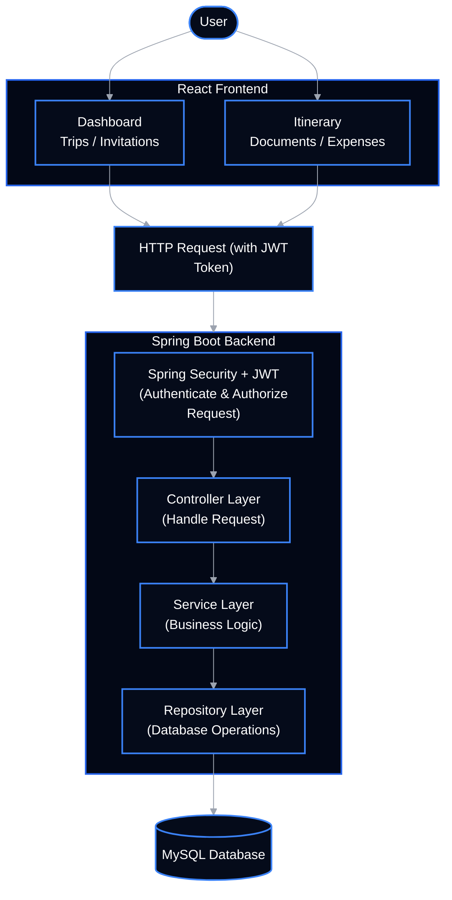
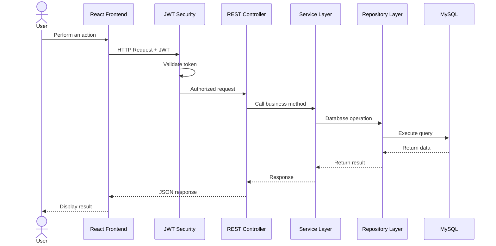
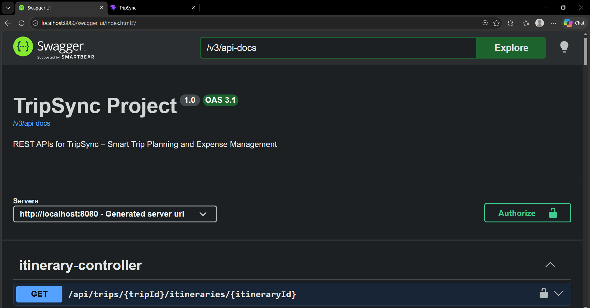
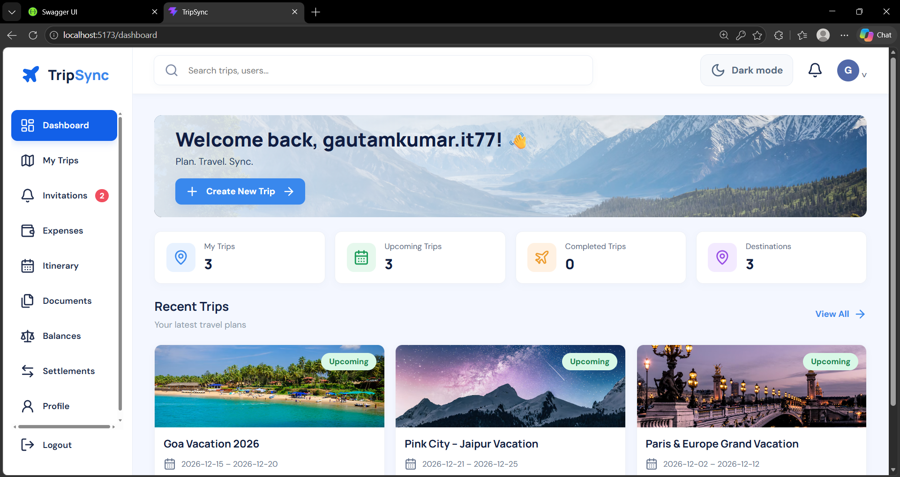
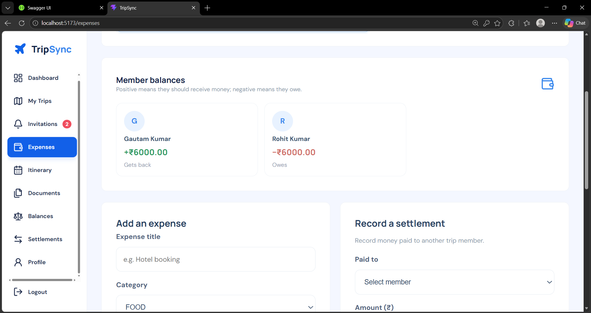
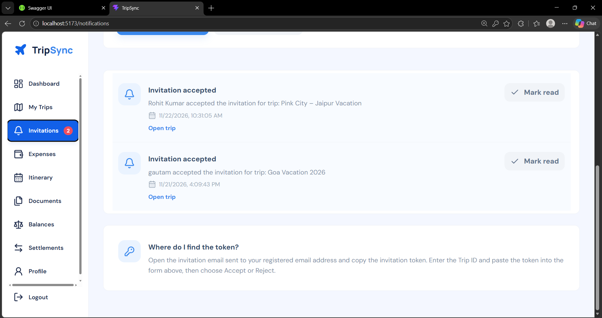
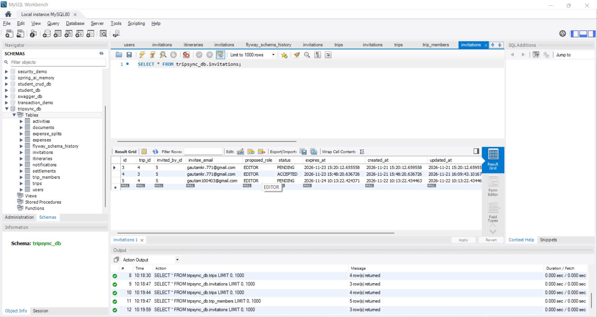

# ✈️ TripSync – Smart Trip Planning & Expense Management

TripSync is a full-stack trip planning and expense management application built to help users organize trips, collaborate with members, manage travel itineraries, store important documents, and split expenses.

The application provides a centralized platform where users can plan and manage their trips while keeping travel-related information organized.

## 🚀 Key Features

- **User Authentication:** Secure registration, login and JWT-based authentication.
- **Trip Management:** Create, view and manage trips with destinations and travel dates.
- **Trip Invitations:** Invite members to trips with different access roles.
- **Itinerary Management:** Organize daily travel plans and activities.
- **Document Management:** Upload, view and download trip-related documents.
- **Expense Management:** Add expenses and split costs among trip members.
- **Member Balances:** Track how much each member owes or should receive.
- **Settlements:** Record payments between trip members.
- **Notifications:** Receive notifications about trip invitations and related activities.

## 🛠️ Technology Stack

| Category | Technologies |
|---|---|
| Backend | Java, Spring Boot |
| Frontend | React, Vite, JavaScript |
| Security | Spring Security, JWT |
| Database | MySQL |
| ORM | Spring Data JPA, Hibernate |
| API Documentation | Swagger / OpenAPI |
| Email Integration | JavaMailSender, SMTP |
| Build Tool | Maven |

## 🏗️ System Architecture


TripSync follows a layered backend architecture. The React frontend communicates with the Spring Boot backend through REST APIs.




### Request Processing Flow



## 💡 Backend Concepts Implemented

The backend demonstrates practical implementation of the following Spring Boot and Java concepts:

- Layered Architecture – Controller, Service and Repository.
- RESTful API Development.
- Spring Security and JWT Authentication.
- Role-Based Authorization.
- DTO (Data Transfer Object) Pattern.
- Bean Validation.
- Spring Data JPA and Hibernate.
- Entity Relationships and Database Mapping.
- Custom Exception Handling.
- Transaction Management.
- File Upload and Download.
- Email Integration using SMTP.
- API Documentation using Swagger / OpenAPI.

## 📸 Application Screenshots

### 1. Swagger API Documentation

Shows the API documentation generated using Swagger / OpenAPI.



### 2. Application Dashboard

Displays the dashboard with trip information, destinations and upcoming travel plans.



### 3. Expenses and Member Balances

Displays expense management, member balances and settlement functionality.



### 4. Invitations and Notifications

Displays trip invitation notifications and their acceptance status.



### 5. Data stored
The User Registered and all the Activities



## ⚙️ How to Run the Project

### Prerequisites

- Java Development Kit
- Maven (or Maven Wrapper)
- Node.js and npm
- MySQL Server

### 1. Clone the Repository

```bash
git clone <YOUR_GITHUB_REPOSITORY_URL>
cd TripSync
```

### 2. Configure the Database

Create a MySQL database:

```sql
CREATE DATABASE tripsync_db;
```

Configure your database username, password and other application properties in the backend configuration.

Configure your email SMTP settings if you want to use invitation email functionality.

Do not commit passwords, JWT secrets or other private credentials to GitHub.

### 3. Run the Backend

Open the backend directory:

```bash
cd backend
```

Run the Spring Boot application using the Maven Wrapper:

**Windows:**

```powershell
.\mvnw spring-boot:run
```

The backend runs at:

`http://localhost:8080`

Swagger documentation:

`http://localhost:8080/swagger-ui/index.html`

### 4. Run the Frontend

Open another terminal from the project root:

```bash
cd frontend
npm install
npm run dev
```

The frontend runs at:

`http://localhost:5173`

## 👨‍💻 Project Structure

```text
TripSync/
│
├── backend/
│   ├── src/
│   ├── pom.xml
│   └── ...
│
├── frontend/
│   ├── src/
│   ├── package.json
│   ├── vite.config.js
│   └── ...
│
├── docs/
│   └── screenshots/
│       ├── swagger-api.png
│       ├── dashboard.png
│       ├── expenses-balances.png
│       └── invitations.png
│
├── README.md
└── .gitignore
```

## 🎯 Project Objective

TripSync was developed to demonstrate full-stack application development using React and Spring Boot, with a focus on backend development, secure REST APIs, database management and practical business logic.

---

**TripSync – Plan. Travel. Sync.**